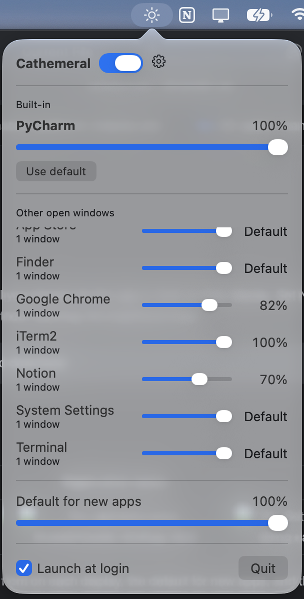
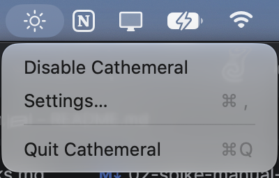
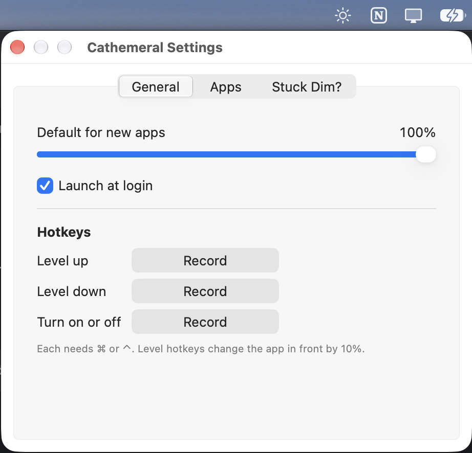

# Cathemeral

Per-app brightness for macOS.

Cathemeral is a menu bar app that dims each display to a level you choose for the app in front on that display. Set Notion to 40% once, and the screen showing Notion dims to 40% whenever it's there, without touching the brightness keys.

> **Status:** early build, installed from source. There is no signed download.

## Screenshots

| Menu bar popover | Right-click menu | Settings |
| :---: | :---: | :---: |
|  |  |  |

Click the menu bar icon for the popover: the level of the app in front on each display, the default for new apps, and the other open windows. Right-click it for the quick menu. Settings holds the default level, Launch at login, hotkeys, the saved levels per app, and what to do if the screen stays dim.

## Install

Cathemeral has no signed release, so you build it from this repo. It takes a few minutes, and a locally built app opens without a Gatekeeper warning.

**With Claude Code:** clone the repo, open Claude Code in it and ask it to "install Cathemeral". The project skill in [`.claude/skills/install-cathemeral`](.claude/skills/install-cathemeral/SKILL.md) does everything else: it checks macOS and Xcode, builds, installs and opens the app, and stops to ask you only for anything that needs `sudo` or the App Store. **If you use it, skip the manual steps below.**

### Manual install

**Needs:** macOS 14 or later, and Xcode 16 or later from the App Store (the Command Line Tools alone aren't enough).

1. Clone the repo and select Xcode:
   ```sh
   git clone https://github.com/ravi-03/cathemeral.git
   cd cathemeral
   sudo xcode-select -s /Applications/Xcode.app/Contents/Developer   # once, if xcodebuild -version fails
   ```
2. Build the Release app:
   ```sh
   xcodebuild -project Cathemeral.xcodeproj -scheme Cathemeral -configuration Release \
       -destination "platform=macOS,arch=$(uname -m)" -derivedDataPath build/DerivedData -quiet build
   ```
3. Quit any running copy, then install it and open it:
   ```sh
   osascript -e 'quit app id "io.github.ravi-03.cathemeral"'
   rm -rf /Applications/Cathemeral.app
   ditto build/DerivedData/Build/Products/Release/Cathemeral.app /Applications/Cathemeral.app
   open /Applications/Cathemeral.app
   ```

The app has no Dock icon, only the menu bar icon. Turn on **Launch at login** in the popover to keep it running. To update, `git pull` and repeat steps 2 and 3. Your settings live in `~/Library/Application Support/Cathemeral/` and survive reinstalls.

**Uninstall:** quit the app, delete `/Applications/Cathemeral.app`, and optionally `~/Library/Application Support/Cathemeral/`.

## How it works

- **One level per app.** Each app has its own level (10–100%) or uses the default level. Apps are identified by bundle ID.
- **One owner per display.** Each display shows the level of its *display owner*: the app most recently brought to the front there or, once that app leaves, the app with the topmost visible window. A display with no visible app isn't dimmed.
- **Gamma, not backlight.** Dimming scales each display's gamma table, so it stacks on top of the system brightness and never touches it. It needs only public APIs and no permissions.
- **Never stuck dark.** Gamma is restored on quit, crash, hang, sleep/wake and display changes. A small watchdog helper restores it if the app dies or freezes.

Target: macOS 14+, Apple silicon and Intel. Built in Swift and SwiftUI, installed from source (see [Install](#install)).

## If your screen is stuck dim

The dimming lives only in memory, so a restart always clears it. The 10% floor keeps the screen readable enough for these steps, fastest first:

1. **Quit the app:** menu bar icon → Quit, or ⌥⌘Esc → Cathemeral → Force Quit.
2. **Reload the colour profile:** System Settings → Displays → Color profile. Pick another profile, then the original again.
3. **Sleep and wake the display:** close and open the lid, or unplug and replug the external monitor.
4. **Log out or restart:** always works.

The brightness keys, Night Shift and True Tone won't fix it, because they don't touch the gamma table.

## Building

Needs Xcode 16 or later (developed on Xcode 27.2).

- `scripts/check` runs `swift format lint`, the tests and the app build, and exits non-zero on any failure. CI runs it too, and so does the pre-commit hook, which the first run of `scripts/check` turns on.
- `Tools/e2e.sh` checks dimming end to end on the real screen (see `Tools/README.md`).
- `swift test --package-path Packages/BrightnessCore` runs the tests alone.
- Open `Cathemeral.xcodeproj` to run the app.

The code is split into `Packages/BrightnessCore` (the rules, no AppKit), `Packages/BrightnessPlatform` (macOS wrappers) and the thin app target in `App/Cathemeral`.

## Project docs

- [`CONTEXT.md`](CONTEXT.md): the glossary (display owner, app setting, level, paused display, and so on). Use these terms in code, issues and discussion.
- [`docs/adr/`](docs/adr/): architecture decision records, starting with [ADR 0001: per-display gamma dimming](docs/adr/0001-per-display-gamma-dimming.md).
- [`docs/agents/`](docs/agents/): configuration for the agent skills (issue tracker, triage labels, domain docs).
- Issues and PRDs live as local markdown files under `.scratch/`.

## License

[MIT](LICENSE)
